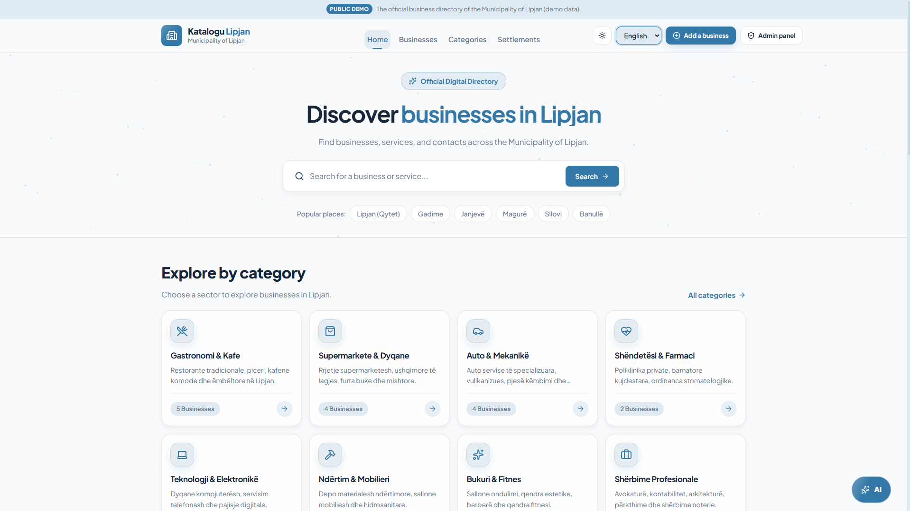
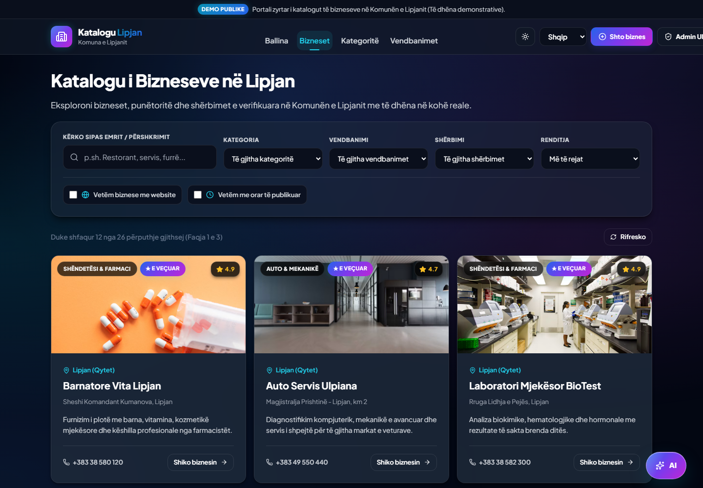

# Katalogu i Bizneseve të Komunës së Lipjanit

Platformë **Full-Stack** për gjetjen, kërkimin, filtrimin dhe kontaktimin e bizneseve në territorin e Komunës së Lipjanit.  
Projekt studentor i bazuar në dokumentin zyrtar `Projekti-01-Katalogu-i-bizneseve.pdf` (Shkolla Digjitale Lipjan, Praktika Profesionale 2026/27). Përputhja me kërkesat duhet verifikuar me skenarët e testimit para dorëzimit.

## Pamje nga aplikacioni

Pamje reale e faqes kryesore gjatë ekzekutimit lokal:





---

## 🛠️ Staku Teknologjik
- **Frontend**: React 19 (SPA me Vite), Leaflet (Hartat me OpenStreetMap), Lucide Icons, CSS Modular Responsive.
- **Backend**: Laravel 12 API, Eloquent ORM, RESTful JSON Endpoints, Custom Token Authentication Middleware.
- **Baza e të Dhënave**: MySQL (MariaDB).
- **Rregull Arkitekturor**: React nuk lidhet drejtpërdrejt me MySQL; të gjitha të dhënat filtrohen, validohen dhe shërbehen nga Laravel API.

---

## 🚀 Udhëzimet e Nisjes së Projektit

### 1. Baza e të Dhënave (MySQL)
Nisni MySQL në XAMPP ose në mjedisin tuaj dhe krijoni databazën `katalogu_lipjan`. Kopjoni `backend/.env.example` në `backend/.env`, gjeneroni `APP_KEY` me `php artisan key:generate`, pastaj vendosni `DB_*` sipas MySQL-it tuaj. Mos e zëvendësoni `.env` me kredenciale publike dhe mos i bëni commit.

### 2. Backend (Laravel API)
```bash
cd backend
composer install
php artisan key:generate
php artisan migrate
php artisan serve --host=127.0.0.1 --port=8000
```
Backend API do të jetë i qasshëm në: `http://127.0.0.1:8000/api`

Konfiguroni `backend/.env` me parametrat e databazës suaj para migrimit. Në instalim të ri, ekzekutoni `php artisan db:seed` vetëm pasi të keni vendosur kredencialet lokale të administratorit. Seeder-i nuk krijon ose rivendos llogarinë e administratorit pa `DEMO_ADMIN_EMAIL` dhe `DEMO_ADMIN_PASSWORD`; vendosini vetëm lokalisht para seedimit të parë. Ekzekutimi i përsëritur i seeder-it nuk e ndryshon llogarinë ekzistuese. `migrate:fresh` i fshin tabelat dhe nuk duhet përdorur në databazë me të dhëna që doni t’i ruani.

Regjistrimi i administratorëve është i mbyllur si parazgjedhje. Për një adresë të autorizuar, vendoseni `ADMIN_REGISTRATION_EMAILS` në `.env` (mund të ketë disa adresa të ndara me presje) dhe konfiguroni dërgimin e email-it. Mos përdorni kod global të përbashkët ftese.

### 3. Frontend (React + Vite)
```bash
cd frontend
npm install
npm run dev
```

Për API në një adresë tjetër, kopjoni `frontend/.env.example` në `frontend/.env` dhe caktoni `VITE_API_BASE_URL` (p.sh. `http://127.0.0.1:8000/api`). Ky është konfigurim publik i adresës së API-së; mos vendosni çelësa sekretë në ndryshoret `VITE_*`.
Portali publik do të jetë i qasshëm në: `http://localhost:5173`

---

## 🔑 Kredencialet e Administratorit
- Paneli: `http://localhost:5173/admin`
- Në mjedis lokal, krijoni llogarinë demo duke vendosur `DEMO_ADMIN_EMAIL` dhe `DEMO_ADMIN_PASSWORD` në `backend/.env` para seedimit. Përdorni fjalëkalim unik dhe mos e vendosni në README, GitHub ose prodhim.

---

## 📌 Veçoritë Kryesore të Implementuara

1. **Faqja Kryesore (Ballina)**:
   - Kërkim qendror me fushë & Enter.
   - Sektorët ekonomikë dhe shkurtore për vendbanimet kryesore.
   - Banner reklamimi i etiketuar qartë si *"E sponsorizuar / Reklamë"*.
   - Biznese të përzgjedhura në mënyrë dinamike nga MySQL.

2. **Katalogu Publik i Bizneseve (`/bizneset`)**:
   - **Kërkim me tekst**: sipas emrit, përshkrimit dhe adresës, me mbështetje për karaktere shqipe (ë/e).
   - **Filtrat Dinamikë**: Kategori, Vendbanim dhe Shërbime nga databaza.
   - **Filtrat Statikë**: Vetëm me uebfaqe, Vetëm me orar të publikuar.
   - **Renditja**: Më të rejat, A-Z, Z-A, Më të vlerësuarat.
   - **Faqezimi (Pagination)**: 12 biznese për faqe me numrin total të përputhjeve.
   - **Ruajtja në URL**: Të gjithë parametrat e kërkimit ruhen në `searchParams` të URL-së (`kerko`, `kategoria`, `vendbanimi`, `sherbimi`, `website`, `orari`, `renditja`, `faqe`).
   - **Harta me Leaflet**: E etiketuar *"Bizneset e kësaj faqeje"* që vendos pin-a interaktivë për të gjitha bizneset e faqes aktive me popup dhe link në profil.

3. **Profili i Biznesit (`/bizneset/:id`)**:
   - Emri, kategoria, vendbanimi, adresa, vlerësimi me yje.
   - Përshkrimi i plotë dhe lista e shërbimeve konkrete.
   - Orari i punës (kur mungon, shfaqet saktësisht *"Orari nuk është publikuar"*).
   - Harta e dedikuar Leaflet me pin-in e biznesit.
   - Butonat e veprimit: *"Telefono"* (`tel:`) dhe *"Shiko udhëzimet"* (hap hartën me rrugën deri te destinacioni).
   - **Mbrojtje e plotë**: Bizneset `draft` ose `archived` nuk shfaqen dhe kthejnë mesazh të qartë 404.

4. **Paneli i Administrimit (`/admin`)**:
   - **Autentikim & Mbrojtje**: Hyrje me email & fjalëkalim; ruajtje e sigurt me Bearer Token; refuzim automatik i vizitorëve të paautorizuar (HTTP 401/403).
   - **Statistika Reale**: Numri i bizneseve të publikuara, drafteve, të arkivuara dhe reklamave aktive direkt nga baza e të dhënave MySQL.
   - **CRUD Bizneseve**: Shtim, modifikim, ndryshim të shpejtë të statusit (`published`, `draft`, `archived`) dhe fshirje me konfirmim duke treguar emrin e biznesit.
   - **Rregulli i Arkivimit**: Kur një biznes arkivohet, reklamat e tij të lidhura çaktivizohen automatikisht.
   - **CRUD Kategorive, Vendbanimeve & Shërbimeve**: Shtim, ndryshim dhe fshirje nga databaza; fshirja bllokohet kur biznesi përdor shërbimin/kategorinë/vendbanimin. Ndryshimi i emrit të shërbimit përditëson etiketat e lidhura të bizneseve.
   - **Menaxhimi i Reklamave**: Mbështetje për të 4 statuset: `active`, `scheduled`, `expired`, `disabled` me kontroll të periudhës kohore dhe prioriteteve.

5. **Asistenti i katalogut**:
   - Asistenti lundrues është i qasshëm në faqet publike dhe punon në Shqip e Anglisht; asistenti i panelit admin përdor endpoint-in e mbrojtur.
   - Biseda zanore përdor Web Speech API të shfletuesit: fjalët e njohura dërgohen si tekst te endpoint-i ekzistues Laravel dhe përgjigjja lexohet me zë. Modaliteti zanor vazhdon me radhë të reja; përfshin heshtjen, ndalimin e të folurit dhe gjendje për mikrofonin/përpunimin.
   - Audioja nuk ngarkohet në endpoint-et tona dhe nuk ruhet nga faqja. Njohja mund të varet nga shërbimi i të folurit që përdor vetë shfletuesi. Mbështetja dhe zërat Shqip/Anglisht ndryshojnë sipas shfletuesit dhe sistemit; teksti mbetet i përdorshëm kur zëri nuk mbështetet.
   - Kërkesat si “më dërgo te bizneset/kategoritë/vendbanimet/admin” hapin faqen përkatëse. Paneli `/admin` vazhdon të kërkojë hyrje të vlefshme dhe asistenti nuk anashkalon autorizimin.
   - Kërkimet për biznese, kategori dhe vendbanime vazhdojnë të përdorin vetëm të dhënat reale nga databaza. Pyetjet e përgjithshme dërgohen nga Laravel te OpenAI Responses API; çelësi nuk dërgohet në frontend.

Për pyetjet e përgjithshme të asistentit, vendosni `OPENAI_API_KEY` në `backend/.env`; modeli i parazgjedhur është `gpt-4.1-mini` dhe mund të ndryshohet te `OPENAI_MODEL`. Modeli i vjetër `gpt-4` është mbyllur. Merrni çelësin nga OpenAI Platform; mos e vendosni në `frontend/.env`, në kod apo në GitHub. Pa çelës, kërkimet e katalogut vazhdojnë të funksionojnë dhe pyetjet e përgjithshme japin mesazh konfigurimi.
   - Kërkimet në katalog tolerojnë gabime të vogla në shkrim dhe shfaqin të dhënat reale me lidhje drejt faqeve përkatëse. Pyetjet e përgjithshme marrin përgjigje gjeneruese nga OpenAI.
   - Endpoint-i publik kufizohet në 5 kërkesa në minutë / 60 në ditë për IP; endpoint-i i panelit admin mbetet i mbrojtur me token.
   - Historia e bisedës ruhet në `sessionStorage` vetëm për sesionin aktual të shfletuesit dhe mund të pastrohet me **Bisedë e re**.

### Testimi i bisedës zanore

Nisni Laravel API dhe React në dy terminale:

```powershell
cd backend
php artisan serve --host=127.0.0.1 --port=8000
```

```powershell
cd frontend
npm run dev
```

Hapni `http://localhost:5173`, lejoni mikrofonin kur shfletuesi e kërkon, zgjidhni bisedën zanore dhe thoni një pyetje për katalogun. Verifikoni që transkriptimi shfaqet si mesazh, Laravel kthen përgjigje nga të dhënat reale dhe shfletuesi e lexon përgjigjen. Pas saj, asistenti dëgjon radhën tjetër. Provoni edhe heshtjen/ndalimin dhe refuzimin e lejes së mikrofonit.

Kontrollet automatike:

```powershell
cd backend
php artisan test --filter=DirectoryAssistantTest
```

```powershell
cd frontend
npm run lint
npm run build
```

---

## 🧪 Testimi

Ekzekutoni testet backend në SQLite të përkohshme (nuk prekin databazën tuaj MySQL):

```bash
cd backend
php artisan test
```

Kontrolloni frontend-in:

```bash
cd frontend
npm run lint
npm run build
```

Rezultatet e fundit dhe gjendja e secilit skenar T-01–T-14 dokumentohen te `TEST_REPORT.md`. Testet automatike të API-së nuk zëvendësojnë provat vizuale në shfletues. Para dorëzimit, përsëritni provat manuale të pambyllura dhe regjistroni demonstrimin/prezantimin e kërkuar.
